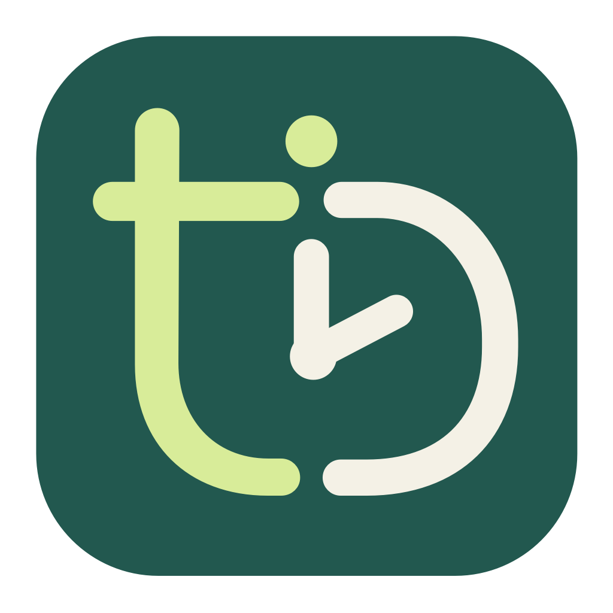
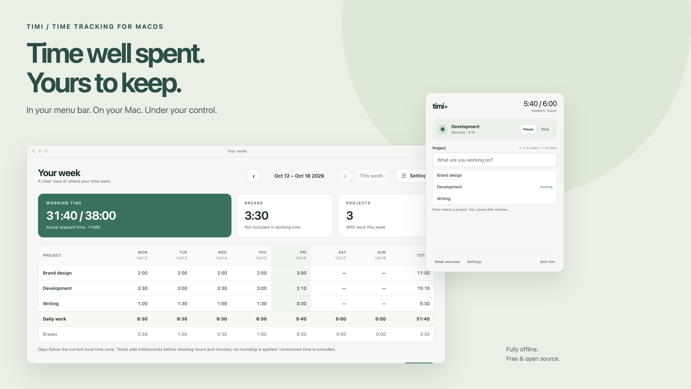
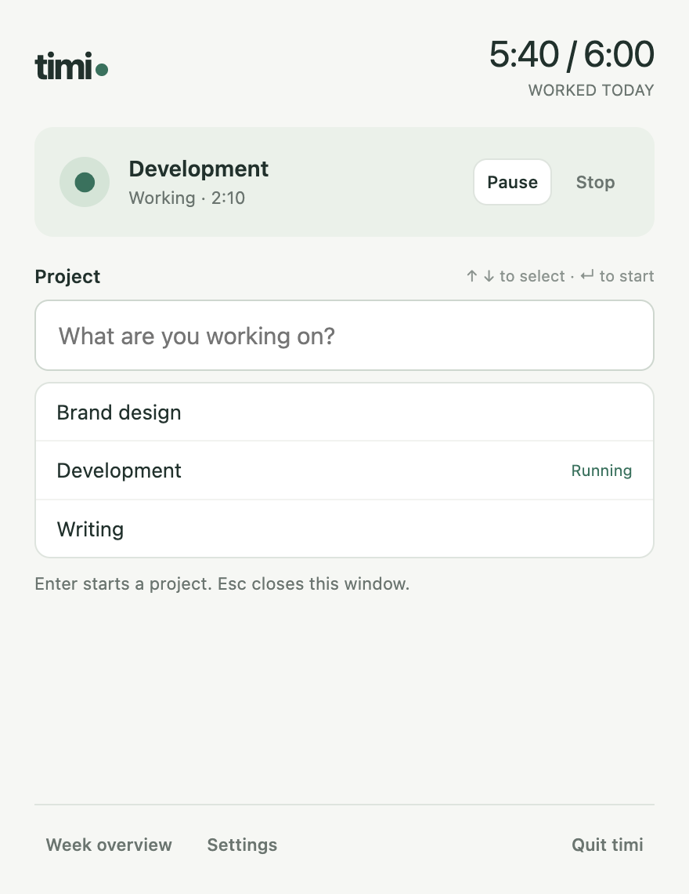
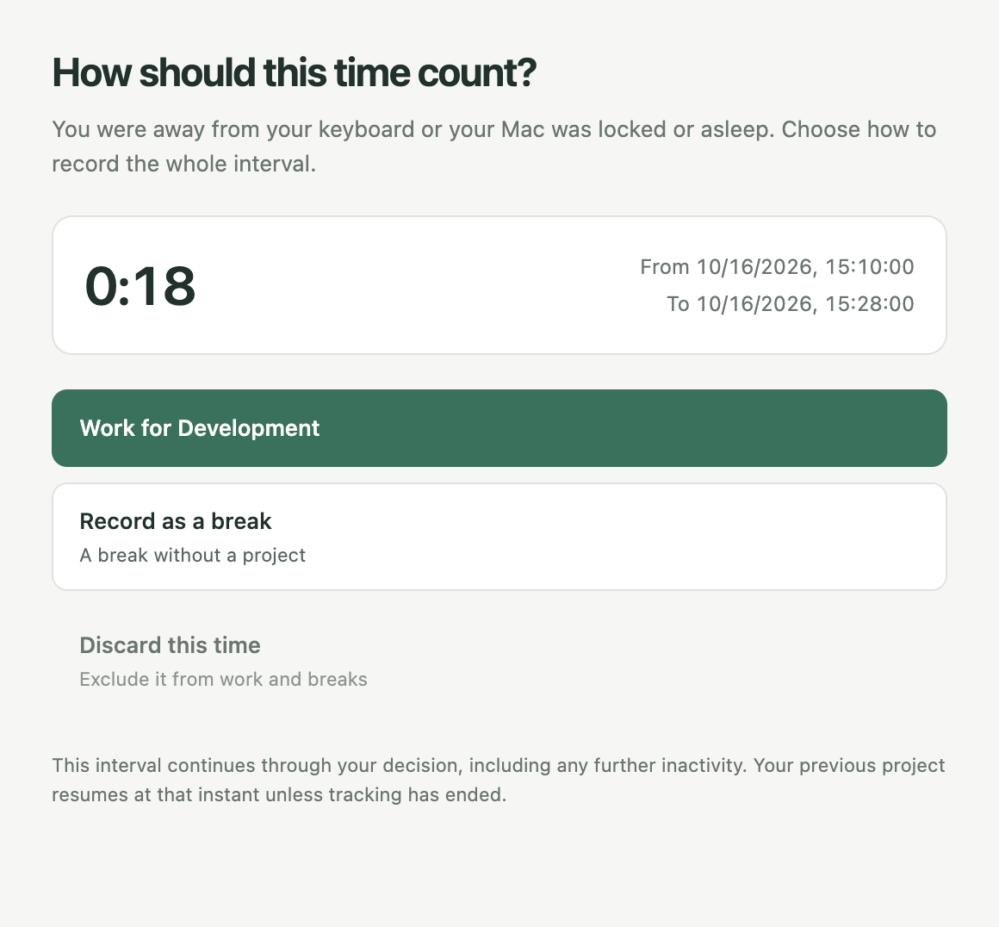
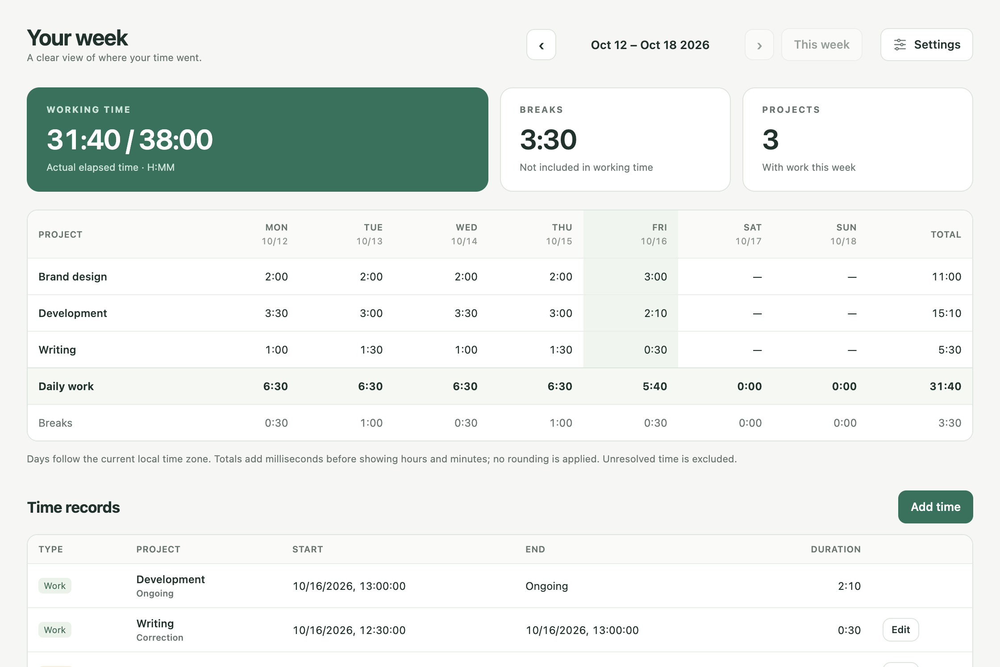
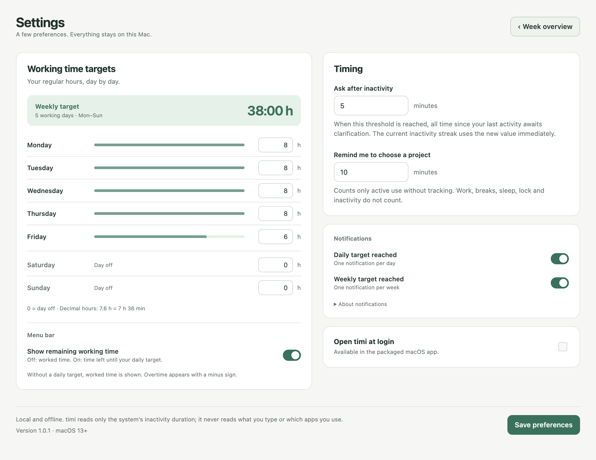
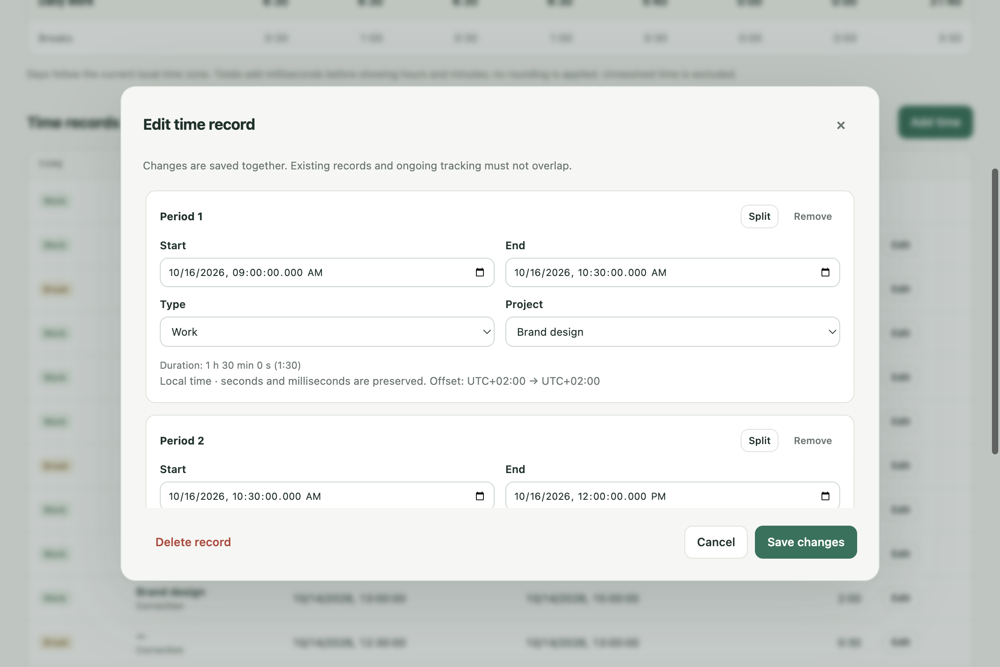

<div align="center">



# timi

### Your time. Your Mac. Your business.

A private menu-bar time tracker for macOS. Set your working hours, see what's left today, and decide how time away should count.

**No account. No subscription. No cloud. Just your time.**

[](https://github.com/Tynamix/timi/releases/latest)
[](https://github.com/Tynamix/timi/releases/latest)
[](LICENSE)

**[Download for macOS](https://github.com/Tynamix/timi/releases/latest/download/timi-mac-universal.zip)** · [Why timi?](#why-timi) · [Working time targets](#a-working-week-that-fits-you) · [Get started](#get-started) · [Contribute](#contribute)

</div>

<p align="center">
  
</p>

timi helps you keep track through the interruptions of a real working day. When you're working without a timer, it reminds you to choose a project. When you step away, lock your Mac, or put it to sleep, it sets that time aside for you to review on return. A meeting can still count as work; a coffee break can stay a break. You decide, and your week stays easy to understand.

## Why timi?

**Step away. Come back. Decide.** During project tracking, timi notices inactivity, screen locking, and sleep. When you return, one question lets you record the time as work on your previous project, record it as a break, or discard it. For inactivity, this covers the entire interval since your last activity. The interval continues until you decide, then your previous project resumes unless you stopped tracking. Time away stays out of your working total until you've classified it.

**A reminder when you forget to start.** It's easy to get straight into work and forget the timer. After 10 minutes of active use without tracking, timi offers to start a project, remind you later, or begin a break. Tracking starts from your choice; missing time can be added separately. You can adjust the reminder and inactivity thresholds independently, and manual breaks suppress both reminders.

**Private by design.** Your records stay on your Mac, and the installed app works entirely offline. There are no accounts, analytics, or synchronization services. To detect inactivity, timi reads how long your Mac has been idle; it never reads what you type or which apps you use.

**Your working week, on your terms.** Set a different target for each weekday, including shorter days and days off. See time worked or time remaining in the menu bar, and optionally get a macOS notification when your daily or weekly target is reached. Reaching a target keeps the timer running; you choose when to stop.

**Small enough to stay out of your way.** Your daily timer sits in the menu bar, with no permanent Dock icon. Type a project and press Enter to start or switch. Pause for a break, Play to continue, Stop when you're done. Every launch starts untracked, so opening the app never starts the clock for you.

**Room to fix a real day.** Add missing time, reassign an entry to the right project, or split it between tasks. Work and breaks stay separate in your weekly overview. Rename or archive projects without losing their history.

## A closer look

<table>
  <tr>
    <td width="50%" valign="top">
      
      <br><strong>Pick a project. Get back to work.</strong><br>
      Keyboard-friendly entry, project suggestions, and today's progress toward your target in one compact window.
    </td>
    <td width="50%" valign="top">
      
      <br><strong>Back from a meeting or a coffee break?</strong><br>
      After inactivity, screen lock, or sleep, choose work, break, or discard for the whole interval.
    </td>
  </tr>
</table>

### Your week, at a glance

Daily totals by project, breaks shown separately, and individual records when you want the detail. The current week shows your working time alongside your weekly target. Browse previous weeks and keep archived projects in your history.



### A working week that fits you

Eight-hour weekdays, a shorter Friday, or weekend work: enter your own hours for Monday through Sunday in **Settings → Working time targets**. Use `0` for a day off. Decimal points and commas both work: `7.6` or `7,6` means **7 hours 36 minutes**. The weekly target is calculated from all seven days; targets are optional and start at zero.



Enable **Show remaining working time** to count down to today's target in the menu bar. For a six-hour day:

| Time worked | Menu-bar timer | Meaning |
| :--- | :--- | :--- |
| 5:40 | `0:20` | Twenty minutes left |
| 6:00 | `0:00` | Daily target reached |
| 6:15 | `−0:15` | Fifteen minutes overtime |

Leave the switch off to show time worked. On days without a target, timi also shows worked time. The preference survives restarts, and hovering over the timer always shows today's worked total. A remaining partial minute rounds up so the countdown doesn't reach zero early.

**A nudge when you've done your hours.** Enable daily and weekly target notifications separately. Only confirmed work counts; breaks and unresolved time away are excluded. Notifications are recorded so they don't repeat in the same local day or week after restarting, changing a target, or correcting an entry. Clicking one opens the weekly overview. Allow timi in **System Settings → Notifications**; macOS notification settings and Focus control how it appears.

**One window for your week and preferences.** Open **Settings** from the overview, then use **Week overview** to go back. Both views share a resizable window and preserve your selected week and unsaved preferences while you switch. Settings from the tracker or menu bar opens the same window directly.

<details>
<summary><strong>Made a mistake? Edit, split, or add time.</strong></summary>

Adjust start and end times, change project assignments, split a period, or delete an entry. Conflicts are explained before any records change. Finish current recording before editing that interval.



</details>

<sub>Real app screenshots with fictional project names and sample records. The header image arranges two app captures on a presentation background.</sub>

## Get started

1. **[Download timi for macOS](https://github.com/Tynamix/timi/releases/latest/download/timi-mac-universal.zip)** — one universal app for Apple Silicon and Intel, macOS 13 or later.
2. Unzip and drag **timi.app** into **Applications**.
3. Open timi, click its menu-bar clock, type a project name, and press **Enter**.

The current download is ad-hoc signed and **not notarized by Apple**. If macOS blocks the first launch, use **System Settings → Privacy & Security → Open Anyway**. Releases include `SHA256SUMS` for archive verification; see the [installation guide](docs/guide.md#install-and-run).

### A few things that make the day easier

| When you… | timi… |
| :--- | :--- |
| Forget to start | Offers a reminder after 10 minutes of active use without tracking. Nothing is backfilled. |
| Step away | Sets aside the whole interval since your last activity after 5 minutes of inactivity by default, then asks how it should count when you return. |
| Lock your Mac or put it to sleep | Sets time aside immediately and asks you to classify it after your Mac is awake and unlocked. |
| Switch tasks | Starts the selected project and ends the previous interval at that instant. |
| Need a break | Records a separate, projectless break. Play resumes your previous project. |
| Have different hours on different days | Saves a target for each weekday and calculates your weekly target. Use zero for days off. |
| Want to know what's left today | Counts down to your daily target in the menu bar and shows overtime with a minus sign. |
| Reach your daily or weekly target | Can send one macOS notification per day or week; tracking continues until you stop. |
| Want your own rhythm | Lets you configure idle and reminder thresholds independently. Manual breaks suppress both reminders. |
| Prefer German | Follows the macOS per-app language setting, with English and German included. |
| Want timi ready at login | Offers optional launch at login in the packaged app, always starting untracked. |

The menu bar also makes the tracking state visible: `■` means untracked, `Ⅱ` means a break, and `!` means time needs clarification or an error needs attention. During work, it shows the timer without a status prefix.

## Your records stay yours

Your data lives at:

```text
~/Library/Application Support/timi/tracking.sqlite
```

To back up, quit timi and copy the whole data directory.

SQLite transactions and durable checkpoints keep changes consistent. If a write fails, timi preserves the previous state and lets you retry; a failed quit leaves the app open. After a crash, recovery stops at the latest durable checkpoint. It never invents working time while the app was closed or resumes tracking on its own.

The interface runs in sandboxed Electron renderers with context isolation, validated IPC, and blocked runtime network access. The platform-neutral tracking core has no Electron imports. Only macOS is currently shipped.

[Data, recovery, and migration details →](docs/guide.md#data-and-recovery)

## Run from source

You'll need **macOS**, **Node.js 22.14+**, and **Xcode Command Line Tools**. Dependency installation and packaging require internet access; the installed app works offline.

```sh
git clone https://github.com/Tynamix/timi.git
cd timi
npm ci
npm start
```

For a separate development database:

```sh
npm start -- --data-directory=/tmp/timi-sandbox
```

Built with **Electron · TypeScript · plain HTML/CSS · SQLite**.

```sh
npm run check              # Type checking, core tests, and build
npm run test:native        # Real Electron integration checks on a Mac desktop
npm run package:universal  # Package for Apple Silicon and Intel
```

See the [build guide](docs/guide.md#build-and-verify) for host-architecture builds and packaged-app checks, and [verification notes](docs/verification.md) for test coverage and native testing limits.

## Contribute

Bug reports, thoughtful feature ideas, and pull requests are welcome. For a bug, include your macOS and timi versions, steps to reproduce, and what you expected to happen. Please keep personal time records out of public reports.

timi's focus is simple, private project time tracking. It currently has no invoices, integrations, project hierarchies, or CSV export. Changes should preserve its offline behavior, accurate accounting, and safe storage.

Run `npm run check` before opening a pull request. Use a Conventional Commit PR title such as `fix: …`, `feat: …`, or `docs: …`; releases are automated after checks pass on `main`.

- [User and developer guide](docs/guide.md)
- [Verification and known testing limits](docs/verification.md)
- [CI, reviews, and releases](docs/automation.md)
- [Code review rules](AGENTS.md)
- [Refresh the README screenshots](docs/screenshots.md)

## License

[MIT](LICENSE). Free to use, inspect, change, and share.
